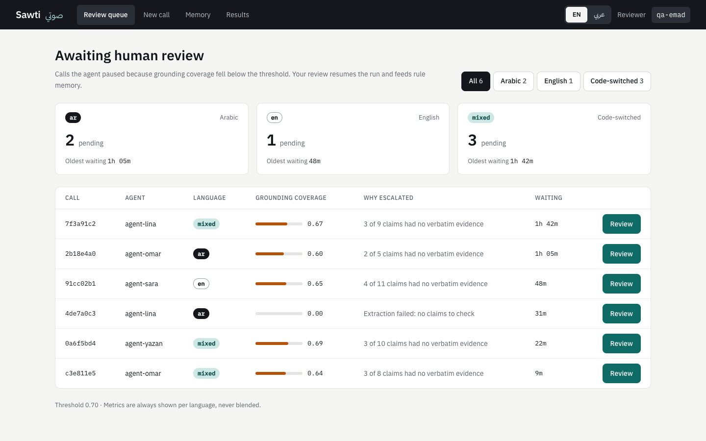
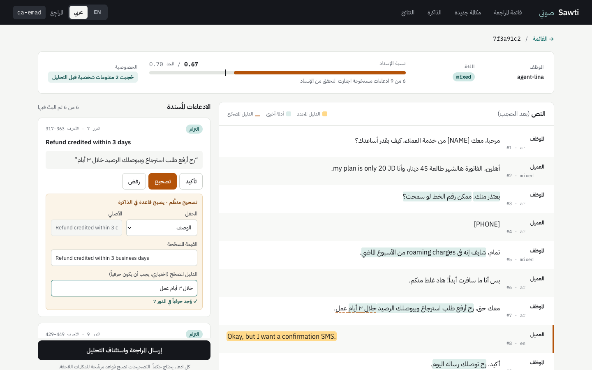
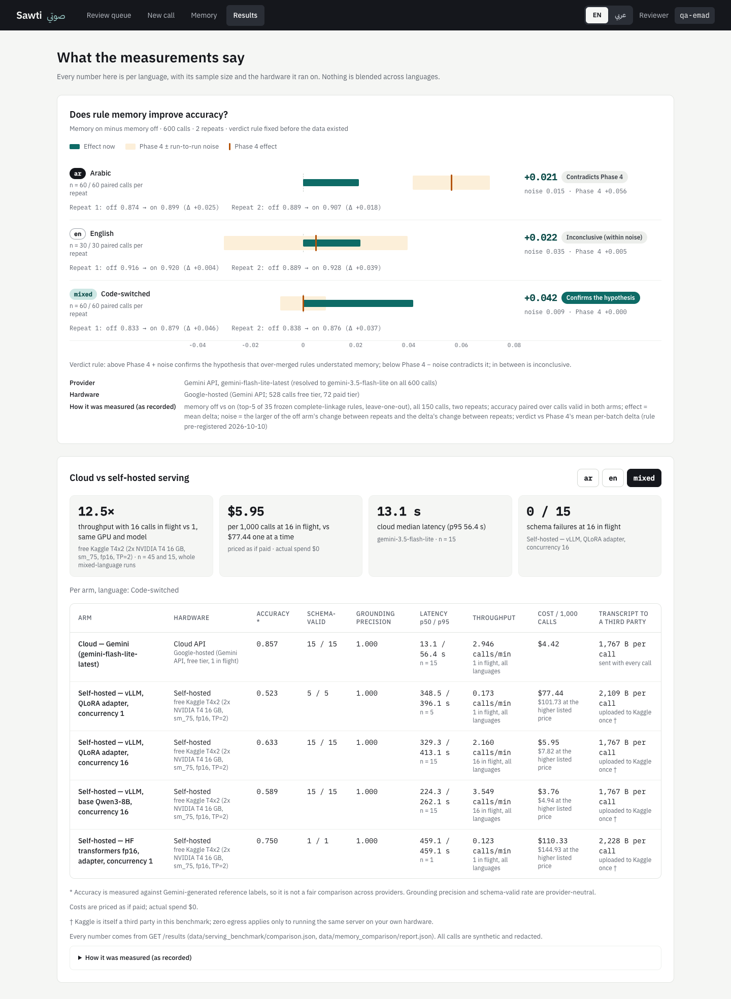

# Sawti — صوتي

**Sawti** is a call-QA agent for Jordanian contact centers. It handles calls in
Arabic, English and code-switched Arabic/English. It transcribes a call,
redacts PII before any text reaches a model, and extracts commitments,
compliance flags, rubric scores and sentiment. **Every claim must quote the
transcript verbatim**, and a claim whose quote isn't there is dropped. Calls
where too few claims survive go to a **human reviewer** instead of getting an
automated verdict. The reviewer's corrections become **rules** that later
analyses retrieve. Every result is reported per language (`ar`, `en`,
`mixed`), never blended.

It runs locally, on synthetic data. It has not been deployed and no real
reviewer has used it. See [Limitations](#known-limitations).

**Demo video:** TODO (link coming).



| Review, Arabic UI (RTL; each transcript turn keeps its own direction) | Results page (every number per language, with n and hardware) |
|---|---|
|  |  |

The screenshots come from the Playwright suite, run against a mocked API. The
Results page mock is the real `/results` response, and a test pins it.

## Architecture

```
audio ─→ ASR (mlx-whisper, forced language) ─→ diarization (pyannote) ─┐
transcript ────────────────────────────────────────────────────────────┴→ PII redaction
   → LangGraph: extract → ground → score → compliance → assess_confidence ─┬→ completed
                                                                           └→ escalate → human review → resume
reviewer corrections → induce rule → conflict check → rule store → retrieved into later extractions
```

- **Service.** FastAPI (it never runs the graph itself), Celery workers,
  Postgres (app tables plus the LangGraph checkpointer, so a paused review
  survives a restart), Redis, and self-hosted Langfuse. They run in Docker
  Compose.
- **Native on the Mac.** The ASR worker runs natively, because mlx-whisper
  needs Metal. So does the React + Vite dashboard, in English and Arabic.
- **LLM.** Gemini (`gemini-flash-lite-latest`) by default. Qwen3-8B on vLLM was
  benchmarked as the self-hosted alternative.

Details: [docs/04-ARCHITECTURE.md](docs/04-ARCHITECTURE.md) (with a diagram)
and [docs/03-TECHNICAL-SPECIFICATION.md](docs/03-TECHNICAL-SPECIFICATION.md).

## Key numbers

Every number is per language and links to its round in
[`eval_results.md`](eval_results.md). Accuracy is measured against
**Gemini-generated** reference labels, not human labels. All audio is
synthetic TTS.

**ASR word error rate**, normalized, 150 calls, language forced
([2026-09-25 ASR quality](eval_results.md)):

| | ar | en | mixed |
|---|---|---|---|
| WER | 0.153 | 0.064 | **0.433** |
| Rubric agreement lost, clean → ASR text | −0.037 | −0.012 | **−0.149** |

**Memory effect.** Accuracy with memory on minus memory off, 600 calls in 2
repeats, under a verdict rule fixed before the data existed
([2026-10-10 memory comparison](eval_results.md)):

| | ar | en | mixed |
|---|---|---|---|
| Effect now | +0.021 | +0.022 | +0.042 |
| Noise | 0.015 | 0.035 | 0.009 |
| Phase 4 effect | +0.056 | +0.005 | 0.000 |
| Verdict on "Phase 4 understated memory" | contradicts | inconclusive (within noise) | confirms |

**Serving: vLLM vs Gemini.** Free Kaggle T4×2 against the Gemini free tier, 15
calls per language, priced as if paid (actual spend $0)
([2026-10-10 cloud vs self-hosted](eval_results.md)):

| | ar | en | mixed |
|---|---|---|---|
| Cost / 1,000 calls: Gemini vs vLLM base Qwen3-8B (16 in flight) | $4.62 vs $4.34 | $4.39 vs $3.80 | $4.42 vs $3.76 |
| Latency p50: Gemini vs vLLM base (16 in flight) | 6.3 s vs 239.7 s | 8.1 s vs 203.1 s | 13.1 s vs 224.3 s |

- **The 12.5× is batching, not a Gemini comparison.** vLLM at 16 calls in
  flight serves **12.5×** the throughput of vLLM at 1 call, on the same GPUs
  and model (2.160 vs 0.173 calls/min with the adapter). It is **17.6×** HF
  transformers.
- Against Gemini, throughput is similar. The base model at 16 in flight does
  3.55 calls/min, and Gemini with one call in flight does 2.95.
- Throughput was measured once per arm, on a mixed-language workload, so it
  isn't split by language.
- The Phase 5 QLoRA adapter didn't pay for itself. Its accuracy was within
  ±0.05 of the base model, its throughput 39% lower.

**ASR latency.** Native M1, mlx-whisper + pyannote, 3 calls per language
([2026-10-11 A1](eval_results.md)):

| | ar | en | mixed |
|---|---|---|---|
| Real-time factor (pooled) | 1.22 | 1.25 | 1.27 |
| Processing time per call, mean | 99.4 s | 175.5 s | 126.4 s |

ASR is slower than real time. Diarization on the CPU is most of the cost.

**Redaction, before → after the 2026-10-11 fix.** Run on the 150 Phase 3 ASR
transcripts, redaction only ([2026-10-11 found in production and catch-all
rounds](eval_results.md)):

| | ar | en | mixed |
|---|---|---|---|
| PII spans caught | 2 → 19 | 1 → 26 | 10 → 16 |
| Runs of 7+ digits left unredacted | 17 → 0 | 25 → 0 | 6 → 0 |

The fix came after a phone number in an uploaded call got past the redactor
and reached Gemini. Afterwards, a live re-upload of the same call showed
`[PHONE]` in its place.

## Known limitations

The full, honest self-review is in [docs/PROJECT-AUDIT.md](docs/PROJECT-AUDIT.md).
The short version:

- **The labels aren't ground truth.** Reference labels are Gemini-generated,
  so "accuracy" means agreement with Gemini. Nobody has reviewed calls through
  the dashboard yet, so reviewer agreement is n = 0.
- **Everything is synthetic:** the transcripts, the TTS audio and the
  corrections.
- **Grounding proves that a quote exists, not that it supports the claim.** A
  garbled ASR transcript still grounded at 1.00 and auto-completed, because
  routing ignores ASR quality. A fix is planned, not built.
- **Code-switched audio is the weak point.** WER is 0.433 on `mixed`.
- **Diarization is coarse and unmeasured.** On one uploaded call, turns mix
  agent and customer speech.
- **Redaction is regex-only.** It doesn't catch personal names (no NER), and
  it leaked once in production (fixed; see above).
- **It's local only.** There is one shared API key, visible in the browser,
  and a self-asserted reviewer id. That isn't authentication.
- **Memory has a known bug.** Consolidation can retire a rule an open
  conflict points at.

Open issues and next steps: [docs/11-CHECKPOINT.md](docs/11-CHECKPOINT.md).
Security details: [docs/13-SECURITY.md](docs/13-SECURITY.md).

## Quick start

You need an Apple Silicon Mac, Docker Desktop, [`uv`](https://docs.astral.sh/uv/),
Python 3.11, Node 20+ and `ffmpeg`.

```bash
cp .env.example .env
```

Fill in `.env`. You need `SAWTI_API_KEY`, `GEMINI_API_KEY`, `HF_TOKEN` (with
the pyannote model terms accepted) and the `LANGFUSE_*` values. The full list
is in [docs/14-DEPLOYMENT.md](docs/14-DEPLOYMENT.md).

```bash
make install
```

```bash
make stack
```

This builds and starts Postgres, Redis, the API, the workers and Langfuse.

```bash
make demo
```

This runs the stack, the native ASR worker and the dashboard together.

Then open the dashboard at <http://localhost:5173>, the API docs at
<http://localhost:8000/docs>, and Langfuse at <http://localhost:3000>. The
walkthrough and recording script are in [docs/DEMO.md](docs/DEMO.md).

Tests and checks:

```bash
make test
```

```bash
make lint
```

```bash
make typecheck
```

As of 2026-10-11: 1,009 Python tests pass, ruff and strict mypy are clean, and
40 frontend unit tests pass. See [docs/15-CONTRIBUTING.md](docs/15-CONTRIBUTING.md).

## Repository map

```
src/sawti/
├── schemas.py      Pydantic models: a claim without a quote is invalid
├── config.py       settings from .env (the only place env is read)
├── privacy/        PII redaction, before any model call
├── asr/            Whisper (forced language), pyannote diarization
├── agent/          LangGraph state, graph and nodes
├── memory/         correction capture, rule induction, conflicts, consolidation
├── llm/            providers: gemini, vllm, anthropic, local HF, fake (tests)
├── eval/           per-language metrics, experiments, serving benchmark
├── observability/  Langfuse tracing (PII-masked)
├── db/             SQLAlchemy models, Alembic migrations, checkpointer
└── api/            FastAPI routes, Celery tasks, ASR task
frontend/           React + Vite dashboard (EN / AR, RTL)
scripts/            measurement and maintenance scripts (each one tested)
tests/              mirrors src/ and scripts/
data/               result records (tracked); audio and transcripts (not tracked)
docs/               numbered project docs
eval_results.md     every measurement, per language, dated
```

## Docs

| | |
|---|---|
| Product | [01 Requirements](docs/01-PRODUCT-REQUIREMENTS.md) · [02 Specification](docs/02-PRODUCT-SPECIFICATION.md) |
| Engineering | [03 Technical spec](docs/03-TECHNICAL-SPECIFICATION.md) · [04 Architecture](docs/04-ARCHITECTURE.md) · [05 Data model](docs/05-DATA-MODEL.md) · [06 API](docs/06-API-SPECIFICATION.md) |
| History | [07 Implementation plan](docs/07-IMPLEMENTATION-PLAN.md) · [08 Roadmap](docs/08-ROADMAP.md) · [09 Decisions](docs/09-DECISIONS.md) · [10 Changelog](docs/10-CHANGELOG.md) |
| State | [11 Checkpoint](docs/11-CHECKPOINT.md) · [12 Testing](docs/12-TESTING.md) · [13 Security](docs/13-SECURITY.md) · [PROJECT-AUDIT](docs/PROJECT-AUDIT.md) |
| Running it | [14 Deployment](docs/14-DEPLOYMENT.md) · [15 Contributing](docs/15-CONTRIBUTING.md) · [16 Style guide](docs/16-STYLEGUIDE.md) · [DEMO](docs/DEMO.md) |
