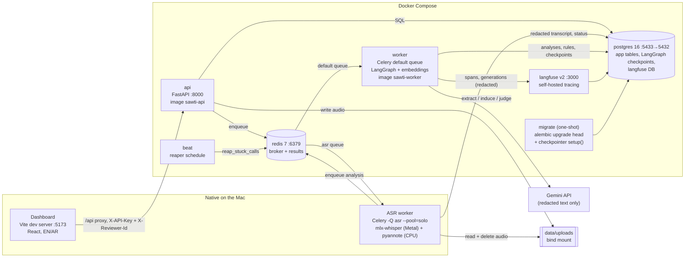

# 04 — Architecture

Everything runs on one machine (an Apple M1 with 8 GB in every measurement).
Most of it runs in Docker Compose. The ASR worker and the dashboard run
natively. How to start it: [14-DEPLOYMENT.md](14-DEPLOYMENT.md). What each
stage computes: [03-TECHNICAL-SPECIFICATION.md](03-TECHNICAL-SPECIFICATION.md).

## Components

| Component | Runs as | Role | Notes |
|---|---|---|---|
| `api` | Docker, `sawti-api` image | FastAPI routes. Redacts at the boundary, writes rows, enqueues tasks. | Never imports or runs the graph, so the image carries no torch (932 MB uncompressed, [eval_results.md](../eval_results.md), 2026-10-07). |
| `migrate` | Docker, one-shot | `alembic upgrade head`, then the LangGraph checkpointer's `setup()` once. | `setup()` is not safe for concurrent first-time callers. |
| `worker` | Docker, `sawti-worker` image | Celery tasks `sawti.analyze_call`, `sawti.resume_call`, `sawti.induce_rules`, `sawti.consolidate_rules`, plus the reaper. | `--concurrency=1`, `acks_late`, prefetch 1. The embedding model is baked in (3.9 GB uncompressed). Cold start is 3.9–5.4 s ([eval_results.md](../eval_results.md), 2026-10-07). |
| `beat` | Docker, `sawti-api` image | Schedules `reap_stuck_calls`. | Exactly one instance. |
| ASR worker | Native (`make asr-worker`) | `sawti.transcribe_audio` on the `asr` queue only: ASR, diarization, redaction, then enqueue the analysis. | Native because mlx-whisper needs Metal, which Docker on macOS can't reach. One file at a time. |
| `postgres` | Docker, `postgres:16-alpine` | App schema (see [05-DATA-MODEL.md](05-DATA-MODEL.md)), LangGraph checkpoint tables, and Langfuse's own database. | Host port `POSTGRES_PORT` (5433 in `.env.example` when a local Postgres owns 5432). |
| `redis` | Docker, `redis:7-alpine` | Celery broker (db 0) and result backend (db 1). | |
| `langfuse` | Docker, `langfuse/langfuse:2` | One trace per graph run, a span per node, a generation per LLM call. | Off unless both keys are set. Every payload string goes through `redact()` first. It used 247 MiB at peak ([eval_results.md](../eval_results.md), 2026-10-07). |
| Dashboard | Native, Vite dev server | The five pages in [02-PRODUCT-SPECIFICATION.md](02-PRODUCT-SPECIFICATION.md). | `make demo` gives it the API key from `.env`, and the key ends up in the browser bundle. |
| Gemini | External | The default LLM provider. | Receives redacted transcripts and rule text only. |

**Not part of the running system.** The 6.3 vLLM benchmark ran Qwen3-8B on a
free Kaggle T4×2 notebook (`notebooks/`, `data/kaggle/`). The service can point
at a vLLM server (`SAWTI_LLM_PROVIDER=vllm`, `VLLM_BASE_URL`), but nothing in
the stack starts one.

## Data flow of one uploaded call

1. `POST /calls/audio` stores the file under `data/uploads` and creates a call
   with status `transcribing`, then enqueues `sawti.transcribe_audio` on `asr`.
2. The ASR worker transcribes, diarizes, labels roles and redacts. It writes
   only the redacted transcript, deletes the audio (unless
   `SAWTI_KEEP_AUDIO=true`), sets status `queued` and enqueues
   `sawti.analyze_call`.
3. The worker claims the call (`queued → processing`, the idempotency guard),
   retrieves memory rules and runs the graph on the Postgres checkpointer.
4. The call ends `completed`, or the graph suspends in `escalate` and the call
   moves to `awaiting_review`.
5. A review submission commits the verdicts and corrections under a row lock,
   then enqueues `sawti.resume_call` (the call becomes `reviewed`) and, if there
   are corrections, `sawti.induce_rules`.

## Why this shape

- **The API never runs the graph.** That keeps the API image small and makes
  every analysis asynchronous and retryable
  ([09-DECISIONS.md](09-DECISIONS.md), 2026-10-07, Phase 6.2).
- **A durable checkpointer.** A paused review survives a process restart
  (`tests/db/test_checkpointer.py`).
  [09-DECISIONS.md](09-DECISIONS.md), 2026-10-06.
- **ASR outside Docker.** CPU Whisper in a container would be the ~0.1×
  real-time path that was rejected
  ([09-DECISIONS.md](09-DECISIONS.md), 2026-10-06, decision 2).
  Measured native ASR is still slower than real time: RTF 1.22 (ar), 1.25 (en),
  1.27 (mixed) pooled, and diarization on the CPU is the larger share
  ([eval_results.md](../eval_results.md), 2026-10-11 A1).

## Limits of this architecture

- Everything is on one host and one Docker VM (3.8 GiB). About four workers is
  the memory ceiling ([eval_results.md](../eval_results.md), 2026-10-07).
- Compose publishes the Postgres, Redis, API and Langfuse ports on all
  interfaces, not only on localhost. See [13-SECURITY.md](13-SECURITY.md).
- The ASR worker is a single process with no horizontal scaling.
