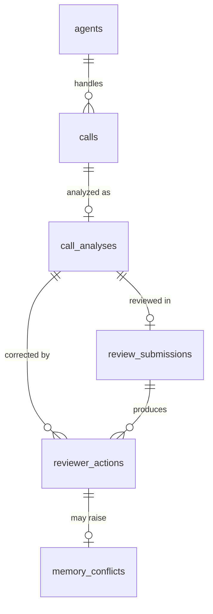

# 05 — Data model

Postgres 16. Alembic owns the schema (`src/sawti/db/migrations/versions/`,
revisions 0001–0005). The ORM models are in `src/sawti/db/models.py`, and
`alembic check` reported no drift between them and the migrations
([09-DECISIONS.md](09-DECISIONS.md), 2026-10-07).
LangGraph's checkpoint tables are **not** in these migrations. The library's
own `setup()` creates them, run once by the `migrate` container.

**Storage rule.** Only redacted text is stored. No table has a column for the
raw transcript, and the PII count column holds a count, never the values
([09-DECISIONS.md](09-DECISIONS.md), 2026-10-06, decision 1).

## Tables

### `agents` (0001)

| Column | Type | Notes |
|---|---|---|
| `id` | uuid PK | |
| `name` | varchar(255) | |
| `external_id` | varchar(255), unique, null | |
| `created_at` | timestamptz | |

These are contact-center agents (records). They are not logins.

### `calls` (0001; 0002, 0004, 0005)

| Column | Type | Added | Notes |
|---|---|---|---|
| `id` | uuid PK | 0001 | |
| `agent_id` | uuid FK → `agents.id` | 0001 | |
| `audio_path` | varchar(1024), null | 0001 (unused until 0005) | Relative to `SAWTI_AUDIO_DIR`. Cleared once the audio is deleted after ASR. |
| `redacted_transcript` | text, null | 0001 | Null while `transcribing`. |
| `language` | varchar(16) | 0001 | `ar` / `en` / `mixed` |
| `occurred_at` | timestamptz | 0001 | |
| `status` | varchar + CHECK | 0001, widened in 0005 | `transcribing` (0005), `queued`, `processing`, `awaiting_review`, `reviewed`, `completed`, `failed` |
| `queued_at`, `started_at`, `finished_at` | timestamptz, null | 0001 | |
| `pii_redacted_count` | int, default 0 | 0001 | Count of replaced spans only. |
| `attempts` | int, default 0 | 0002 | Claims by a worker. This is the source of the retry rate. |
| `enqueued_at` | timestamptz, null | 0004 | Set on every enqueue. The reaper keys on it. |
| `failure_reason` | text, null | 0005 | Never contains transcript text. |

### `call_analyses` (0001)

One per call (`uq_call_analyses_call_id`).

| Column | Type | Notes |
|---|---|---|
| `id` | uuid PK | |
| `call_id` | uuid FK → `calls.id`, unique | |
| `payload` | jsonb | A `CallAnalysis`, never rewritten once stored. |
| `confidence` | float | |
| `requires_human_review` | bool | |
| `created_at` | timestamptz | |
| `grounding_coverage` | float, null | Context for the review screen. |
| `confidence_threshold` | float, null | The threshold in force for this run. |
| `escalation_reason` | text, null | English prose kept for compatibility. The UI uses `EscalationInfo`. |
| `rejected_claims` | jsonb, default `[]` | Claims `ground` dropped. |
| `retrieved_rule_ids` | jsonb, default `[]` | Only service runs record this. Eval-script runs never did. |

### `reviewer_actions` (0001; 0002, 0003)

One row per `Correction`.

| Column | Type | Added | Notes |
|---|---|---|---|
| `id` | uuid PK | 0001 | |
| `call_analysis_id` | uuid FK → `call_analyses.id` | 0001 | |
| `reviewer_id` | varchar(255) | 0001 | Self-asserted (`X-Reviewer-Id`). |
| `payload` | jsonb | 0001 | A `Correction` (`original`, `corrected`, `error_location`, `note`). |
| `created_at` | timestamptz | 0001 | |
| `review_submission_id` | uuid FK → `review_submissions.id`, null | 0002 | Null for Phase 4/5 rows. |
| `induced_at` | timestamptz, null | 0003 | Each correction is induced at most once. |
| `induction_outcome` | varchar(16), null | 0003 | `inserted` or `conflict` |

### `review_submissions` (0002)

| Column | Type | Notes |
|---|---|---|
| `id` | uuid PK | |
| `call_analysis_id` | uuid FK, **unique** | One submission per analysis. A second one gets 409. |
| `reviewer_id` | varchar(255) | |
| `verdicts` | jsonb | Every claim's verdict (confirm / correct / reject). |
| `created_at` | timestamptz | |

### `memory_rules` (0002)

| Column | Type | Notes |
|---|---|---|
| `id` | uuid PK | |
| `rule_text` | text | Redacted before it is stored, because rules go into prompts. |
| `source_correction_ids` | jsonb, default `[]` | |
| `created_at` | timestamptz | |
| `success_count`, `failure_count` | int, default 0 | |
| `retired` | bool, default false | Retired rows are kept, so merges are reversible. |

The current store has 139 rows, of which 23 are active
([eval_results.md](../eval_results.md), 2026-10-11 legacy-conflict round).

### `memory_conflicts` (0005)

| Column | Type | Notes |
|---|---|---|
| `id` | uuid PK | |
| `reviewer_action_id` | uuid FK → `reviewer_actions.id`, **unique** | The correction whose candidate was rejected. |
| `candidate_rule_id` | uuid | The id the candidate would get. It is not a FK, because the candidate is not stored. |
| `candidate_text` | text | Redacted. |
| `conflicting` | jsonb | Per conflicting rule: id, cosine similarity, and the judge's redacted reasoning. |
| `detected_at` | timestamptz | |
| `resolution` | varchar(32), null | CHECK: `keep_existing`, `keep_new`, `discard`, `not_a_conflict` |
| `resolved_by`, `resolved_at` | null | CHECK: set together with `resolution`. |

**Known bug.** A conflict can point at a rule that consolidation later
retired. Nothing links the conflict to the merged rule
([09-DECISIONS.md](09-DECISIONS.md), 2026-10-11 TODO).

## Relationships

`memory_rules.source_correction_ids` points at `reviewer_actions.id` by value.
It is not a foreign key.

## Migration history

| Rev | Date | Change |
|---|---|---|
| 0001 | 2026-10-06 | Initial schema from the Phase 1 `create_all()` shape. `transcript` became `redacted_transcript`. Adds status, timestamps, `pii_redacted_count`, one analysis per call, and the review-screen columns. The dev database was converted in place ([09-DECISIONS.md](09-DECISIONS.md), 2026-10-07). |
| 0002 | 2026-10-07 | `memory_rules`, `review_submissions`, `calls.attempts`, `reviewer_actions.review_submission_id` |
| 0003 | 2026-10-07 | `reviewer_actions.induced_at`, `induction_outcome` |
| 0004 | 2026-10-07 | `calls.enqueued_at` (backfilled from `queued_at`) |
| 0005 | 2026-10-10 | `transcribing` status, `calls.failure_reason`, `memory_conflicts` |

The dates are the `Create Date` in each migration header.
